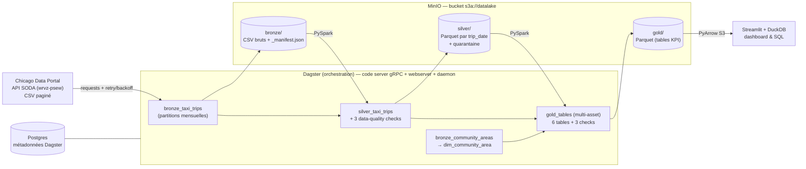

#  Chicago Taxi Trips (Dagster · PySpark · MinIO)

Pipeline de données de bout en bout, orchestré et reproductible en local, qui :

1. **ingère** une tranche du dataset public *Chicago Taxi Trips* via l'API SODA (paginée) dans le datalake (**BRONZE**, CSV bruts non modifiés) ;
2. **nettoie, type, déduplique et contrôle la qualité** des trajets avec Spark (**SILVER**, Parquet partitionné + quarantaine des lignes rejetées) ;
3. **expose des agrégats métier** prêts pour la BI (**GOLD** : revenus par jour, durée moyenne/médiane, top zones de prise en charge, heatmap de la demande, top trajets, mix de paiement, parts de marché des compagnies) ;
4. **sert** ces tables via un dashboard Streamlit avec un explorateur **SQL (DuckDB)**.

Tout tourne en local via **Docker Compose** ; l'orchestration est assurée par **Dagster**.

---

## Sommaire
- [Démarrage rapide](#démarrage-rapide)
- [Architecture](#architecture)
- [Données sources : période choisie et téléchargement](#données-sources--période-choisie-et-téléchargement)
- [Les couches du datalake](#les-couches-du-datalake)
- [Orchestration](#orchestration)
- [Couche d'exposition](#couche-dexposition)
- [Tests](#tests)
- [Choix techniques et arbitrages](#choix-techniques-et-arbitrages)
- [Difficultés rencontrées et résolutions](#difficultés-rencontrées-et-résolutions)
- [Avec plus de temps](#avec-plus-de-temps)
- [Structure du repo](#structure-du-repo)
- [Dépannage](#dépannage)
- [Utilisation d'outils d'IA](#utilisation-doutils-dia)

---

## Démarrage rapide

### Prérequis
| | |
|---|---|
| Docker Engine ≥ 24 + **Docker Compose ≥ 2.24** | `docker compose version` |
| **≥ 8 Go de RAM** alloués à Docker | le driver Spark utilise 3 Go (`SPARK_DRIVER_MEMORY`) ; sous Windows (WSL2), Docker ne reçoit souvent que la moitié de la RAM du PC : `SPARK_DRIVER_MEMORY=2g` suffit |
| ~4 Go d'espace disque | images (Java + Spark ≈ 2 Go) + données |
| Accès Internet | téléchargement des images, des jars S3A et des données SODA |
| `make` *(optionnel)* | chaque cible `make` est une simple commande `docker compose` (voir ci-dessous) |

### Lancement pas à pas

```bash
# 1. Récupérer le projet
git clone <url-du-repo> chicago-taxi-datalake && cd chicago-taxi-datalake

# 2. (optionnel) personnaliser la configuration – le projet tourne sans .env
cp .env.example .env

# 3. Construire et démarrer la stack (MinIO, Postgres, Dagster, dashboard)
docker compose up -d --build            # ou : make up
docker compose ps                        # attendre que dagster-code soit "healthy" (~30 s)

# 4. Déclencher le pipeline de bout en bout : BRONZE -> SILVER -> GOLD
docker compose run --rm pipeline-runner  # ou : make run
```

> **Alternative « une seule commande »** : `docker compose --profile autorun up --build` démarre la stack **et** exécute le pipeline.
>
> **Alternative via l'UI** : ouvrir Dagster → *Assets* → **Materialize all** (Dagster crée un backfill : les 3 mois en un seul run Spark, puis les tables gold).
>
> **Sans Internet / démo rapide** : `make demo` exécute exactement le même pipeline sur des données synthétiques au schéma identique (`SOURCE_MODE=sample`), défauts de qualité inclus.

### Ce que vous obtenez
| Service | URL | Rôle |
|---|---|---|
| **Dagster UI** | http://localhost:3000 | lineage, runs, partitions, data-quality checks, métadonnées |
| **Dashboard BI** | http://localhost:8501 | KPIs, graphiques, explorateur SQL (DuckDB) sur la couche gold |
| **MinIO console** | http://localhost:9001 (`minioadmin` / `minioadmin`) | parcourir le datalake (bucket `datalake`) |

Durée indicative du run complet sur un laptop (Q1 2023, mois complets) : ingestion limitée par l'API SODA (quelques minutes par mois, plus rapide avec un `SODA_APP_TOKEN`), puis quelques minutes de traitement Spark. Pour un premier essai rapide : `INGEST_MAX_ROWS_PER_PARTITION=100000` dans `.env`.

Arrêt : `docker compose down` (données conservées) · `docker compose down -v` (tout supprimer).

---

## Architecture



Vue « conteneurs » :

```
                     ┌──────────────────────── docker compose ────────────────────────┐
  navigateur ──3000──►  dagster-webserver ─┐                                          │
                     │                     ├─gRPC─► dagster-code (code + Spark local) │
                     │  dagster-daemon ────┘        │  runs exécutés ici               │
                     │       (queue, sensors,       │  s3a://                          │
                     │        schedules, backfills) ▼                                  │
  navigateur ──9001──►  minio  ◄──── datalake-init (création du bucket, one-shot)     │
                     │    ▲                                                            │
  navigateur ──8501──►  dashboard (Streamlit + DuckDB, lit gold/ via PyArrow)          │
                     │                                                                 │
                     │  postgres (runs, events, schedules Dagster)                     │
                     │  pipeline-runner (profil "autorun" / make run : one-shot)       │
                     └─────────────────────────────────────────────────────────────────┘
```

---

## Données sources : période choisie et téléchargement

- **Dataset** : *Taxi Trips (2013-2023)*, id Socrata `wrvz-psew` — endpoint `https://data.cityofchicago.org/resource/wrvz-psew.csv`.
- **Période retenue : 1er trimestre 2023** (`2023-01-01` inclus → `2023-04-01` exclu), soit **3 partitions mensuelles** : `2023-01`, `2023-02`, `2023-03`. Ordre de grandeur : quelques centaines de milliers de trajets par mois, soit un volume « quelques millions de lignes max » exploitable sur un laptop. On peut vérifier le volume exact avant de lancer :
  ```bash
  curl -G "https://data.cityofchicago.org/resource/wrvz-psew.json" \
    --data-urlencode "\$select=count(*)" \
    --data-urlencode "\$where=trip_start_timestamp >= '2023-01-01T00:00:00' AND trip_start_timestamp < '2023-04-01T00:00:00'"
  ```
- La période est **paramétrable** (`PERIOD_START` / `PERIOD_END` dans `.env`) : les partitions Dagster s'en déduisent.

**Méthode d'extraction** (`pipeline/taxi_pipeline/ingestion/soda.py`) :
- la période est découpée en **fenêtres d'un jour** : filtre SoQL `trip_start_timestamp >= 'jour' AND trip_start_timestamp < 'jour + 1'` (intervalles semi-ouverts → aucune fenêtre ne se chevauche, aucun trajet n'est perdu ni dupliqué) ;
- un jour compte ~10 à 20 000 trajets, bien moins que la taille de page (`$limit` = 100 000) : chaque fenêtre est récupérée en **une seule requête** ; si une fenêtre dépassait une page, repli sur une pagination `$limit` / `$offset` ordonnée par `trip_start_timestamp, trip_id` ;
- **pourquoi pas `$order=:id`** (la pagination Socrata « classique ») : testé, un tri global sur ce dataset de plus de 200 M de lignes dépasse 120 s et n'aboutit pas, alors qu'une requête filtrée sur un jour répond en ~1 min ;
- les fenêtres sont téléchargées **en parallèle** (`SODA_WORKERS`, 4 par défaut) puis écrites dans l'ordre chronologique ;
- retries avec backoff exponentiel sur 429/5xx (respect de `Retry-After`) et timeouts bornés ; `X-App-Token` optionnel (`SODA_APP_TOKEN`) pour éviter le throttling ;
- plafond optionnel `INGEST_MAX_ROWS_PER_PARTITION` pour réduire le volume (le téléchargement s'arrête dès qu'il est atteint).

**Commandes de téléchargement** :
```bash
# Dans le pipeline (recommandé) : l'asset bronze télécharge et dépose dans MinIO
docker compose run --rm pipeline-runner

# En standalone, vers des fichiers locaux (même code que l'asset bronze)
docker compose run --rm -v "$PWD/data:/data" pipeline-runner \
  python -m taxi_pipeline.ingestion.download --start 2023-01-01 --end 2023-04-01 --out /data/raw
```

Chaque mois ingéré est accompagné d'un `_manifest.json` (requête exacte, nb de lignes, fichiers, horodatages, `run_id` Dagster) : l'ingestion est **auditable et rejouable**.

---

## Les couches du datalake

```
s3a://datalake/
├── bronze/
│   ├── chicago_taxi_trips/ingest_month=2023-01/page_00000.csv … + _manifest.json
│   └── reference/community_areas.csv
├── silver/
│   ├── taxi_trips/trip_date=2023-01-01/part-*.parquet …        (données propres)
│   ├── taxi_trips_rejected/trip_month=2023-01/part-*.parquet    (quarantaine + reject_reason)
│   └── dim_community_area/part-*.parquet
└── gold/
    ├── daily_kpis/  hourly_demand/  pickup_zones_monthly/
    └── top_routes/  payment_mix_daily/  company_monthly/
```

### 🥉 Bronze — brut, immuable
- Les pages CSV renvoyées par l'API sont stockées **octet pour octet** (aucun parsing), partitionnées par mois d'ingestion.
- **Idempotence** : ré-ingérer un mois supprime puis réécrit son dossier.
- Seed de référence : les 77 *community areas* de Chicago (CSV versionné dans le repo).

### 🥈 Silver — propre, typé, contrôlé (`transformations/silver.py`)
1. **Lecture tout en `string`** (pas d'inférence de schéma) → le typage est une étape explicite et maîtrisée ; tolérance au *schema drift* (colonne absente → `null`).
2. **Typage** : timestamps (plusieurs formats supportés), entiers, décimaux (suppression de `$` et `,`), chaînes trimées/normalisées.
3. **Normalisation** : `payment_type` harmonisé (`Prcard` → `Prepaid Card`, casse, vide → `Unknown`), `company` en casse homogène, montants annexes absents (`tips`, `tolls`, `extras`) → 0.
4. **Colonnes dérivées** : `trip_date`, `trip_month`, `pickup_hour`, `day_of_week` (ISO), `duration_min`, `avg_speed_mph`, `tip_pct`.
5. **Règles qualité** — une ligne en échec part en **quarantaine** avec sa raison (la première règle violée) au lieu d'être silencieusement supprimée :

   | Règle | Raison |
   |---|---|
   | `trip_id` nul | `missing_trip_id` |
   | timestamp de début invalide | `invalid_start_timestamp` |
   | trajet hors du mois traité | `outside_partition_window` |
   | fin < début | `end_before_start` |
   | durée ≤ 0 ou nulle | `non_positive_duration` |
   | durée > 6 h | `duration_too_long` |
   | distance < 0, nulle ou > 300 miles | `invalid_distance` |
   | tarif absent | `missing_fare` |
   | montant négatif | `negative_amount` |
   | total > 1 000 $ | `amount_outlier` |
   | vitesse moyenne > 100 mph | `implausible_speed` |

6. **Déduplication** sur `trip_id` (on garde la version la plus récemment ingérée).
7. **Écriture** Parquet partitionnée par `trip_date`, en *dynamic partition overwrite* → rejouer un mois ne réécrit que ses propres jours (**idempotent**).

**Data-quality checks Dagster** (visibles dans l'UI à chaque matérialisation) : unicité de `trip_id`, taux de rejet < `DQ_MAX_REJECT_RATIO` (WARN), partition non vide. Les métadonnées du run donnent le détail : lignes brutes / propres / rejetées / doublons, répartition des raisons de rejet.

### 🥇 Gold — tables analytiques (`transformations/gold.py`)

| Table | Grain | Contenu |
|---|---|---|
| `daily_kpis` | jour | trajets, **revenu total**, revenu tarif / pourboires, ticket moyen, **durée moyenne et médiane**, distance, vitesse médiane, taxis actifs, revenu par taxi, taux de pourboire carte |
| `pickup_zones_monthly` | mois × zone | trajets, revenus, part de marché, **rang** (top zones de prise en charge, noms des quartiers joints) |
| `hourly_demand` | jour de semaine × heure | demande moyenne par jour (heatmap), durée et ticket moyens |
| `top_routes` | origine → destination | top 100 des trajets entre zones (volume, durée, ticket) |
| `payment_mix_daily` | jour × moyen de paiement | répartition des trajets / revenus, pourboire moyen |
| `company_monthly` | mois × compagnie | revenus, flotte active, revenu par taxi, part de marché, rang |

Choix de modélisation : tables **dénormalisées et pré-classées** (les outils BI les consomment telles quelles). Les trajets sans zone (hors Chicago ou masqués pour la confidentialité) sont conservés sous « Unknown / outside Chicago » avec leur part, mais **exclus du classement**.

**Checks gold** : réconciliation du revenu gold ↔ silver, une ligne par jour, somme des parts de zones = 100 %.

---

## Orchestration

Dagster, en approche **Software-Defined Assets** : chaque table du datalake est un asset, le lineage est explicite.


```
bronze_taxi_trips ──► silver_taxi_trips ──┐
   (mensuel)            (mensuel)         ├──► gold_daily_kpis, gold_hourly_demand,
bronze_community_areas ──► dim_community_area ┘   gold_pickup_zones_monthly, gold_top_routes,
                                                  gold_payment_mix_daily, gold_company_monthly
```

| Élément | Rôle |
|---|---|
| **Partitions mensuelles** (bronze, silver) | unité de traitement et de rejeu ; backfill de N mois |
| `BackfillPolicy.single_run()` | un backfill de 3 mois = **1 seul run Spark** (pas 3 démarrages de JVM) |
| `in_process_executor` | toutes les étapes d'un run partagent **une seule SparkSession** |
| `ingest_and_clean_job` | job partitionné bronze + silver |
| `build_gold_job` | dimension + tables gold (full refresh depuis silver) |
| `gold_after_silver_sensor` (actif) | relance automatiquement le gold après chaque succès de `ingest_and_clean_job` |
| `ingest_and_clean_job_schedule` (désactivé) | planification mensuelle « production » (inutile sur un dataset historique) |
| Asset checks | qualité silver et gold, visibles et historisés dans l'UI |
| Concurrence | `max_concurrent_runs: 1` → un seul run Spark à la fois (budget mémoire laptop) |

Déploiement Dagster « comme en production » : un **code server gRPC** (`dagster-code`, qui contient Spark/Java et exécute les runs), séparé du **webserver** et du **daemon** (queue, sensors, schedules, backfills), métadonnées dans **Postgres**.

---

## Couche d'exposition

Dashboard **Streamlit** (http://localhost:8501), qui lit directement les Parquet gold dans MinIO (PyArrow, sans passer par Spark) :
- **Overview** : KPIs de la période (revenu, trajets, ticket moyen, durée moyenne, taxis actifs), revenu par jour, durée moyenne/médiane par jour ;
- **Pickup zones & routes** : top N zones par mois, top trajets origine → destination ;
- **Demand patterns** : heatmap jour × heure ;
- **Payments & companies** : mix de paiement, classement des compagnies ;
- **SQL explorer** : requêtes **DuckDB** libres sur les 6 tables gold.

N'importe quel outil BI capable de lire du Parquet sur S3 (Superset/Trino, Power BI, DuckDB CLI…) peut aussi se brancher sur `s3://datalake/gold/` (endpoint `http://localhost:9000`).

---

## Tests

28 tests `pytest` (dossier `pipeline/tests/`) :
- **silver** : typage, chaque règle qualité (test paramétré), déduplication, normalisation, robustesse au schema drift ;
- **gold** : réconciliation des revenus, formes des tables, classement des zones, parts = 100 % ;
- **ingestion SODA** : clause `$where`, découpage en fenêtres journalières sans chevauchement, ordre chronologique malgré le parallélisme, repli en pagination si une fenêtre dépasse une page, plafond de lignes (session HTTP simulée) ;
- **end-to-end** : les *vraies* définitions Dagster sont matérialisées sur un datalake en système de fichiers local (2 mois + gold), checks inclus, puis **test d'idempotence** (rejouer un mois ne change pas le volume silver).

```bash
make test        # dans l'image Docker
# ou en local (Python 3.11 + Java 17) :
cd pipeline && pip install -e ".[dev]" duckdb && pytest
```

Les transformations sont des **fonctions pures DataFrame → DataFrame** : elles sont testables sans Dagster ni MinIO. Le chemin du datalake (`DATALAKE_ROOT`) bascule entre `s3a://` (Docker) et `file://` (tests).

---

## Choix techniques et arbitrages

| Choix | Pourquoi | Arbitrage / limite |
|---|---|---|
| **Dagster** plutôt qu'Airflow | modèle *asset-centric* naturel pour un datalake médaillon : lineage, partitions, backfills, data-quality checks et métadonnées natives ; stack locale plus légère | moins répandu qu'Airflow chez certains clients |
| **Spark en mode `local[*]`** dans le code server | volume (quelques M de lignes) parfaitement traité par un seul nœud ; pas de cluster à opérer en local | pour scaler : pointer `SPARK_MASTER` vers un cluster (ou Spark Connect / Dataproc / EMR) sans changer le code |
| **PySpark 3.5 (LTS)** | compatibilité éprouvée avec Hadoop 3.3.4 + `hadoop-aws` / AWS SDK v1 (jars légers) | Spark 4 possible, mais connecteur S3A plus lourd (AWS SDK v2) |
| **MinIO** comme stockage objet | API S3 → le même code tourne sur AWS S3 / GCS (via connecteur) / ADLS | les images officielles `minio/minio` ont été retirées de Docker Hub (sept. 2026) : on utilise le build maintenu par Chainguard (`cgr.dev/chainguard/minio`), surchargeable via `MINIO_IMAGE` ; tout stockage compatible S3 convient |
| **Bronze = CSV brut** | fidélité à la source, rejouabilité, audit | stockage moins compact que Parquet (acceptable au regard du volume) |
| **Parquet** en silver/gold (et non Delta/Iceberg) | simplicité, aucun catalogue à opérer | pas de transactions ACID ni de time travel → voir « plus de temps » |
| **Quarantaine** plutôt que suppression silencieuse | traçabilité, possibilité d'analyser / corriger les rejets | stockage supplémentaire |
| **Gold en full refresh** | 3 mois de silver → recalcul en quelques secondes, simple et toujours cohérent | sur des années de données : passer à un recalcul incrémental par partition |
| **Partition silver par `trip_date`** | filtrage efficace par jour/mois côté BI, overwrite dynamique idempotent | ~90 dossiers par trimestre (OK) ; sur plusieurs années, préférer le mois |
| **Un seul run Spark / backfill** + `max_concurrent_runs: 1` | évite plusieurs JVM concurrentes sur un laptop | moins de parallélisme entre mois (compensé par le parallélisme Spark) |
| **Timestamps** | la source fournit l'heure locale de Chicago (arrondie au quart d'heure) ; on la conserve telle quelle, session Spark en UTC pour éviter tout décalage | pas de conversion explicite de fuseau |
| **Mode `sample`** | démo/CI sans dépendre d'une API externe, défauts réalistes injectés | données synthétiques : uniquement pour tester la mécanique |

---

## Difficultés rencontrées et résolutions

Le pipeline a été exécuté de bout en bout sur une machine Windows (Docker Desktop + WSL2). Quatre problèmes réels sont apparus ; chacun est documenté ici, avec sa cause et la correction appliquée.

| Problème observé | Cause | Résolution |
|---|---|---|
| `pull access denied for minio/minio` au `docker compose up` | Les images communautaires officielles de MinIO ont été retirées de Docker Hub et de quay.io (sept. 2026) | Image `cgr.dev/chainguard/minio` : même serveur MinIO, même API S3, maintenue par Chainguard. Elle tourne par défaut avec un utilisateur non-root (UID 65532) → `user: "0:0"` pour éviter les erreurs de permissions sur le volume ; elle ne contient ni `curl` ni `mc` → pas de healthcheck, c'est `datalake-init` qui attend que l'API S3 réponde. Image surchargeable via `MINIO_IMAGE`. |
| `dagster-code` *unhealthy* : `ModuleNotFoundError: No module named 'psycopg'` | SQLAlchemy 2.1 (dépendance transitive de Dagster) a changé son driver Postgres par défaut (psycopg2 → psycopg 3), absent de l'image | Installer psycopg 3 a supprimé le crash mais provoqué `the connection is closed` : `dagster-postgres` est conçu pour psycopg2. Correction retenue : **épingler `sqlalchemy>=2.0,<2.1`** dans `pyproject.toml`, ce qui rétablit psycopg2 (fourni par `dagster-postgres`). Leçon : épingler aussi les dépendances transitives critiques. |
| Ingestion bloquée indéfiniment sur l'étape bronze | La pagination Socrata « classique » (`$order=:id` + `$offset`) impose un tri global sur un dataset de plus de 200 M de lignes | Mesures depuis le conteneur : avec `$order=:id`, aucune réponse après 120 s ; sans tri, ~25 s pour 500 lignes ; une journée complète (~4 Mo) en ~60 s. **Nouvelle stratégie** : une requête par fenêtre d'un jour (intervalles semi-ouverts, sans chevauchement), 4 jours en parallèle, retries et timeouts bornés (voir [Méthode d'extraction](#données-sources--période-choisie-et-téléchargement)). |
| Risque de fins de ligne Windows (`\r`) dans `run_pipeline.sh` | Git sous Windows peut convertir LF → CRLF | `.gitattributes` force LF pour les scripts shell, Dockerfiles et YAML. |

Démarche suivie à chaque fois : lire la dernière ligne de la trace (`docker compose logs <service>`), reproduire le problème isolément (ex. requêtes `curl` chronométrées depuis le conteneur), corriger, puis relancer le pipeline complet.

## Avec plus de temps

- **Format de table transactionnel** (Delta Lake ou Apache Iceberg) en silver/gold : ACID, `MERGE` pour l'upsert de corrections tardives, time travel, compaction, évolution de schéma.
- **Catalogue + moteur SQL** (Hive Metastore / Nessie + Trino) et **Superset** branché dessus, à la place du dashboard maison.
- **Data quality déclarative** (Great Expectations / Soda / dbt tests) et contrats de données sur le schéma source ; alerting (Slack) sur échec de check.
- **Gold incrémental** (partition mappings mensuels) et modélisation des transformations gold en **dbt-spark** pour les équipes analytics.
- **Enrichissements** : météo journalière (corrélation demande/météo), jours fériés, géographie (census tracts, GeoJSON des quartiers pour une carte), comparaison taxis vs VTC (*Transportation Network Providers*, autre dataset du portail).
- **Ingestion** : parallélisation des pages SODA, ingestion incrémentale par `:updated_at`, stockage bronze compressé (gzip).
- **Industrialisation** : CI (lint + tests + build d'images), images multi-stage plus légères, secrets via un vault plutôt que `.env`, `DockerRunLauncher` / `K8sRunLauncher` pour isoler chaque run, observabilité (logs centralisés, métriques Spark).
- **Infrastructure as code** (Terraform) pour déployer la même architecture sur un cloud (S3/GCS + Spark managé + Dagster+).

---

## Structure du repo

```
.
├── docker-compose.yml          # stack complète
├── .env.example                # configuration (période, source, mémoire Spark…)
├── Makefile                    # raccourcis : up, run, demo, test, logs, down, clean
├── docker/
│   ├── dagster/                # Dockerfile (Python + Java 17 + Spark + jars S3A), dagster.yaml, workspace.yaml
│   └── dashboard/Dockerfile
├── scripts/run_pipeline.sh     # déclenchement bout en bout (bronze+silver puis gold)
├── dashboard/app.py            # couche d'exposition (Streamlit + DuckDB)
└── pipeline/                   # package Python `taxi_pipeline`
    ├── pyproject.toml
    ├── taxi_pipeline/
    │   ├── definitions.py      # Definitions Dagster : assets, jobs, sensor, schedule, resources
    │   ├── config.py           # configuration par variables d'environnement + layout du datalake
    │   ├── partitions.py       # partitions mensuelles
    │   ├── resources.py        # SparkResource, DatalakeResource
    │   ├── storage.py          # écriture brute S3 (boto3) / filesystem local
    │   ├── bootstrap.py        # création du bucket (service datalake-init)
    │   ├── ingestion/          # client SODA paginé, générateur sample, CLI de téléchargement
    │   ├── transformations/    # logique Spark pure : silver.py, gold.py
    │   ├── assets/             # assets Dagster : bronze.py, silver.py, gold.py
    │   └── reference/          # seed des community areas
    └── tests/                  # unitaires + end-to-end
```

---

## Dépannage

| Symptôme | Piste |
|---|---|
| `pull access denied for minio/minio` | ancienne version du repo : l'image officielle n'existe plus, utiliser `cgr.dev/chainguard/minio:latest` (valeur par défaut actuelle) |
| `No module named 'psycopg'` ou `the connection is closed` (Dagster) | vérifier que `pipeline/pyproject.toml` contient `sqlalchemy>=2.0,<2.1`, puis `docker compose up -d --build` |
| Ingestion bloquée sur `bronze_taxi_trips` | API SODA lente : vérifier avec `docker compose logs`, réduire `SODA_WORKERS` si erreurs 429 |
| `dagster-code` reste `starting` | `docker compose logs dagster-code` ; la première construction de l'image télécharge ~2 Go |
| Run Spark tué (OOM, exit 137) | augmenter la RAM Docker ou baisser `SPARK_DRIVER_MEMORY` / `INGEST_MAX_ROWS_PER_PARTITION` |
| Erreurs 429 de l'API SODA | renseigner `SODA_APP_TOKEN` (gratuit) ; les retries avec backoff gèrent les pics ponctuels |
| Pas d'accès Internet | `make demo` (données synthétiques, même pipeline) |
| Dashboard vide | le pipeline n'a pas encore produit le gold : `make run` puis rafraîchir |
| `env_file … required` non reconnu | Docker Compose trop ancien (< 2.24) : mettre à jour, ou `cp .env.example .env` |

---

## Utilisation d'outils d'IA

J'ai utilisé un assistant IA pour structurer le projet, générer une partie du code et des tests, et m'aider à diagnostiquer les problèmes et les erreurs rencontrés lors de l'exécution sur ma machine (voir [Difficultés rencontrées et résolutions](#difficultés-rencontrées-et-résolutions)). J'ai personnellement réalisé l'exécution, le développement, les ajustements et la vérification du pipeline de bout en bout en local.


Thank you For your Time